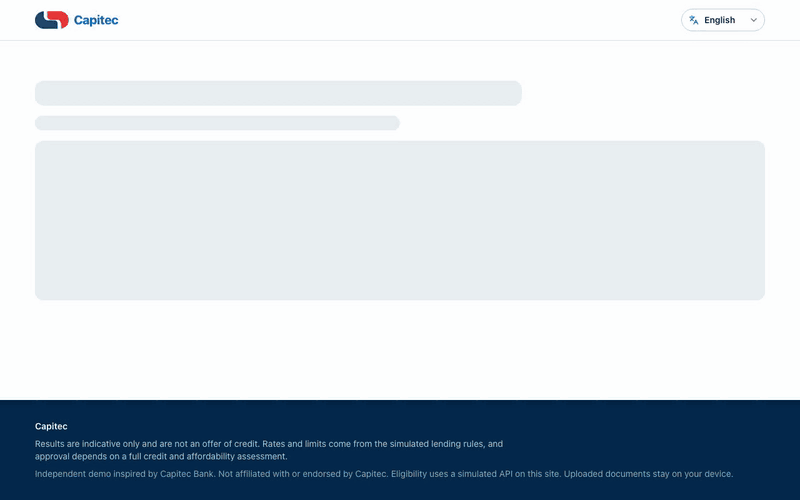

# Capitec Loan Simulator

Independent demo of a loan affordability and eligibility flow. Estimate a monthly instalment, see whether it fits a budget, then walk through the documents an application needs.

Answers stay in the browser. Uploaded documents stay on the device. Lending rules come from a simulated API served with the app. This project is not affiliated with or endorsed by Capitec Bank. Results are indicative and are not an offer of credit.

## Try it

The simulator is live at [https://capitec-loan-simulator.seni-tembe.workers.dev/](https://capitec-loan-simulator.seni-tembe.workers.dev/).



The same recording is available as a video file: [demo/walkthrough.mp4](demo/walkthrough.mp4).

## Prerequisites

- [Git](https://git-scm.com/)
- [Node.js](https://nodejs.org/) 20 or newer. `.nvmrc` pins 20. Node 18.18 is the oldest version the app accepts. Docker images and CI use Node 24.
- Yarn 1.22.22, enabled through Corepack (included with Node):

```bash
corepack enable
corepack prepare yarn@1.22.22 --activate
```

Docker is optional. Use it when you want to run the app without installing Node.

## Clone

```bash
git clone https://github.com/mindsgn/capitec.git
cd capitec
```

SSH works the same way: `git clone git@github.com:mindsgn/capitec.git`.

## Run locally

```bash
cd frontend
cp .env.example .env
yarn install --frozen-lockfile
yarn dev
```

Open [http://localhost:5173](http://localhost:5173).

| Path | Page |
| --- | --- |
| `/` | Landing page |
| `/simulator` | Affordability and eligibility flow |

The dev server also serves the mock loan API under `/api/loans`.

`VITE_SITE_URL` in `frontend/.env` is the public origin used in page metadata. The default in `.env.example` is fine for local use. Vite reads it when the app starts or when you build.

## Production build

From `frontend/`:

```bash
yarn build
yarn start
```

Open [http://localhost:3000](http://localhost:3000).

`yarn build` typechecks the app, builds the static files, and bundles the production server. `yarn start` serves those files and the same mock API. Set `PORT` if 3000 is taken, for example `PORT=8080 yarn start`.

Set `VITE_SITE_URL` in `frontend/.env` before `yarn build`. Vite writes that value into the built files, so changing it after the build has no effect until you build again.

## Docker

### Published image

A push to `main` publishes the production image to GitHub Container Registry. Pull `latest` and run it:

```bash
docker pull ghcr.io/mindsgn/loan-simulator:latest
docker run --rm -p 3000:3000 ghcr.io/mindsgn/loan-simulator:latest
```

Open [http://localhost:3000](http://localhost:3000). A healthy container answers `GET /api/loans/products`.

`latest` tracks `main`. Each build is also tagged with the full commit SHA, `ghcr.io/mindsgn/loan-simulator:<sha>`, so you can pin a known build or roll back to one.

The published image is built with `VITE_SITE_URL=http://localhost:3000` unless the `VITE_SITE_URL` repository variable is set. Vite writes that origin into the app during the image build.

Before anyone else can pull the image, the package has to be public. On GitHub, open the `loan-simulator` package, then **Package settings** and **Change visibility** to Public. That step is once per package.

To hand someone the image without a registry, save it and send the file:

```bash
docker pull ghcr.io/mindsgn/loan-simulator:latest
docker save ghcr.io/mindsgn/loan-simulator:latest | gzip > loan-simulator.tar.gz
```

They load it and run the same tag:

```bash
docker load < loan-simulator.tar.gz
docker run --rm -p 3000:3000 ghcr.io/mindsgn/loan-simulator:latest
```

### Run from this repository

Development, with source in `frontend/src` synced into the container:

```bash
docker compose up --build dev
```

Open [http://localhost:5173](http://localhost:5173).

Production image, built on this machine:

```bash
docker compose up --build prod
```

Open [http://localhost:3000](http://localhost:3000).

The same production image without Compose:

```bash
docker build --build-arg VITE_SITE_URL=http://localhost:3000 -t loan-simulator .
docker run --rm -p 3000:3000 loan-simulator
```

Replace `VITE_SITE_URL` with the public origin when you build an image for a real host. To publish that build yourself:

```bash
docker tag loan-simulator ghcr.io/mindsgn/loan-simulator:latest
docker login ghcr.io
docker push ghcr.io/mindsgn/loan-simulator:latest
```

## Tests

From `frontend/`:

```bash
yarn typecheck
yarn test
```

End-to-end tests use Playwright against the production server on port 4173. Install the browsers once, then run the suite:

```bash
yarn e2e:install
yarn e2e
```

`yarn e2e --project=chromium` runs Chromium only. `yarn e2e:ui` opens the Playwright UI.

Record a fresh walkthrough. Typing and selections are paced slowly so the recording is easy to follow. This needs [ffmpeg](https://ffmpeg.org/), and it writes `demo/walkthrough.mp4` and `demo/walkthrough.gif`:

```bash
yarn demo
```

## Layout

| Path | Role |
| --- | --- |
| `frontend/` | React app (Vite, TypeScript, Yarn) |
| `frontend/server/index.ts` | Production server for the built app and `/api/loans` |
| `frontend/src/mocks/loansApi.ts` | Simulated lending API |
| `Dockerfile` | Production image |
| `Dockerfile.dev` | Development image |
| `compose.yml` | `dev` and `prod` services |
